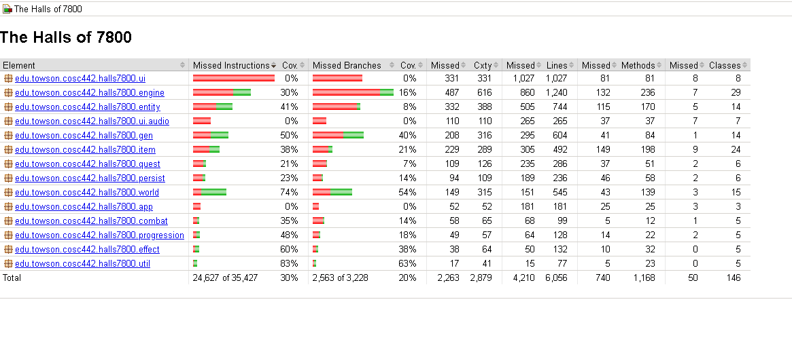

# First Looks

At FIRST LOOK THE QUALITY.YML FILE NEEDED FIXING
- Added PIT TEST
- Spot Bugs

It seems like all 14 Basic test given to us pass with no fail but the quality is definately trash. I got that from pulling the jacoco report

Over 740 methods missed, thats a lot over the span of:

146 Classes, 14 Test, 30% Coverage

[Initial PIT Run failed so running PIT in increments]

# Issues Found - Github Issues explains in more detail

- Improvement on test coverage
- Combat testing is lacking
- 47 Potnetial quality problems found by SPOTBUGS

Count Name                     
----- ----                     
   23 CT_CONSTRUCTOR_THROW     
   12 EI_EXPOSE_REP            
    6 EI_EXPOSE_REP2           
    3 MS_PKGPROTECT            
    1 ICAST_IDIV_CAST_TO_DOUBLE
    1 IM_BAD_CHECK_FOR_ODD     
    1 DCN_NULLPOINTER_EXCEPTION

# Inital Baseline and Risk Assesment Full v.

The initial assessment of *The Halls of 7800* revealed significant weaknesses in automated testing and potential software reliability risks.

Although all 14 existing JUnit tests passed, JaCoCo reported only **30% instruction coverage** and **20% branch coverage**. Much of the application's behavior therefore remains untested by the current suite.

PIT mutation testing of the combat package reported **20% mutation coverage** and **52% test strength**, suggesting limited test effectiveness. SpotBugs also identified **47 medium-priority warnings** requiring investigation.

### Risk Prioritization

| Risk | Supporting Evidence | Priority |
|---|---|---|
| Save/load and replay inconsistencies | Beta-user report; persistence instruction coverage of 23% | High |
| Inventory and purchasing defects | Beta-user report; item instruction coverage of 38% | High |
| Combat correctness | Beta-user report; combat mutation coverage of 20% | High |
| Quest progression defects | Beta-user report; quest instruction coverage of 21% | High |
| Dungeon progression bypass | Beta-user report involving a trapdoor bypassing a boss | High |
| Potential code-quality problems | 47 SpotBugs warnings | Medium |
| Untested UI and audio behavior | 0% automated instruction coverage in both packages | Medium |

These are preliminary risk ratings. Reported defects have not all been independently reproduced, and priorities may change after investigation.

### Planned Quality Improvements

- [ ] Add targeted JUnit 5 tests for high-risk gameplay systems.
- [ ] Investigate and fix selected beta-reported defects.
- [ ] Improve instruction, branch, and mutation coverage.
- [ ] Investigate and resolve significant SpotBugs findings.
- [ ] Improve GitHub Actions continuous integration checks.
- [ ] Introduce at least one additional SQA tool or technique not previously required in the course.
- [ ] Verify improvements and compare final metrics against the initial baseline.

### Assessment Limitations

Passing tests do not guarantee that the game is defect-free. Likewise, SpotBugs warnings are potential problems rather than confirmed bugs.

The initial full-project PIT run encountered repeated worker timeouts. The recorded **20% mutation coverage applies only to the combat package** and must not be presented as the project's overall mutation score.

### Initial Conclusion

The Halls of 7800 successfully compiles and passes its existing automated tests, but the available testing evidence is insufficient to establish strong reliability. Improvements should prioritize core gameplay correctness, regression protection, test effectiveness, and maintainability.

Final measurements will be compared with this baseline to evaluate the impact of the changes.
  